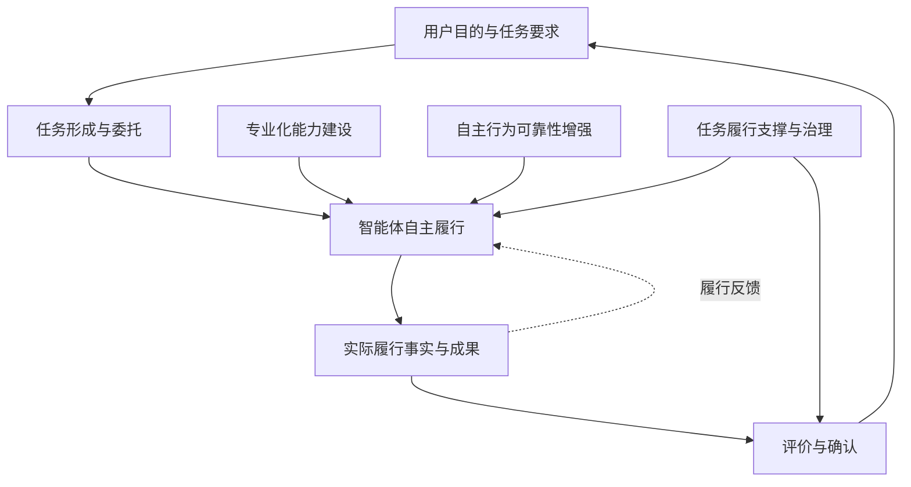

# 00 总体说明

> 文档状态：整合修订稿，待评审  
> 修订日期：2026-11-27  
> 编制依据：2026-11-24《00_总体说明》早期稿，以及后续关于总体定位、智能体构成、概念体系、场景驱动领域建模和增量研发模式的讨论结论。本稿不是此前会话最终正文的逐字恢复；尚未明确的设计留待后续研究与验证。

## 第1章 编制背景与目的

### 1.1 建设背景

以大语言模型为基础的智能体已经能够理解自然语言要求，获取环境信息，利用工具开展工作，并根据执行反馈调整后续行动。由智能体引擎、大语言模型和必要作业能力构成的智能体，即使没有专门的任务型智能体平台，也可以独立接受用户委托、履行任务并产生工作成果。

然而，具备自主行动能力并不意味着智能体已经具备稳定、可靠地履行专业任务的能力。用户希望获得的不仅是智能体的响应，而且是满足任务要求的实际工作结果；在具有明确作业要求、权限边界及质量要求的场景下，履行过程同样需要符合相应约束，并能够说明结果的形成依据。

单纯增加模型能力、提示词长度或工具数量，不能直接解决专业能力组织、自主行为可靠性、任务履行连续性以及履行结果的可信判定等问题。

本项目以普通智能体已经具备的自主行动能力为基础，研究如何通过智能体自身的专业化设计与行为机制增强，以及平台提供的支撑和治理能力，使智能体能够更加可靠地承担并履行实际任务。

### 1.2 建设目的

建设一个面向实际任务履行的任务型智能体平台，支持专业智能体的构建、任务的形成与委托、自主行为的实施、履行过程的支撑与治理，以及对履行结果的有依据评价和确认。

平台的建设目的不是消除智能体的自主性，也不是将智能体退化为固定工作流中的执行节点，而是在任务要求、专业知识、作业规范和有效授权的共同作用下，使其自主行为及实际成果尽可能符合用户预期。

可靠性是需要通过持续研究与实际验证逐步提高的建设目标，而不是平台存在即可保证任务成功的先验结论。

### 1.3 研究主线

本项目以任务履行为总体研究主线：

**人的目的 → 任务形成 → 任务委托与承担 → 智能体自主行动 → 实际履行及成果 → 评价与确认。**

专业能力为任务履行提供基础，自主行为机制使智能体能够利用专业能力开展工作，平台提供任务履行所需的外部支撑与治理保障。

研究既关注智能体本身如何工作，也关注智能体与任务、用户、专业能力资源、作业规范、作业环境和平台之间如何建立合理的领域关系。

### 1.4 本文档的定位

本文档是平台研究与工程建设的总体入口，负责阐明建设背景、平台定位、总体设计思想、建设领域、研究边界及研发路线。

它不替代概念体系、领域模型、核心机制及工程设计文档，不提前确定全部实体结构、状态模型、接口、算法或软件组件。后续文档在本说明指导下逐步深化，并通过实际研发反馈对总体认识进行必要的受控修订。

## 第2章 平台定位与职责

### 2.1 平台的性质与定位

任务型智能体平台是面向实际任务履行的支撑与治理系统，以任务履行为业务中心，以智能体自主行为为行为中心。

平台支持智能体在明确任务要求、有效授权和适用规范的条件下承担工作，提供必要的专业化配置、运行支撑、人机协作、信息组织、履行记录及评价确认能力。

智能体是承担任务并开展自主行为的计算实体；平台是支持和治理任务履行的系统。二者具有相互协作的关系，不能将智能体自主行为全部等同于平台的运行管理行为。

### 2.2 平台的服务对象与价值

| 服务对象 | 主要价值 |
| --- | --- |
| 任务提出者与委托者 | 明确工作要求，委托适当的智能体，并了解实际履行情况与成果 |
| 专业智能体的建设者 | 组织专业知识、方法、技能、工具及规范，构建具有特定专业能力的智能体 |
| 任务履行参与者与管理者 | 在必要时提供信息、澄清要求、作出授权、处理异常或开展评价确认 |
| 智能体 | 获得履行任务所需的环境、信息、资源及运行支撑，并在约束范围内开展自主行动 |

上述服务对象是领域角色，不预先规定具体软件账户、权限角色及组织结构。同一用户可以承担不同角色。

### 2.3 平台的基本使用模式

平台的基本使用模式可从三个相互关联的方面理解：

1. **专业能力准备与智能体构建。** 组织可复用的专业能力资源、作业规范及智能体定义，为特定领域工作构建适当的智能体。
2. **任务委托与自主履行。** 用户提出工作要求，形成任务并建立承担关系；智能体在有效约束下自主理解任务、选择行动、利用资源和环境开展工作。
3. **履行支撑与评价确认。** 平台支持交互、运行、信息与记录的持续管理，在必要时实施约束检查、异常处理及履行评价，为任务完成确认提供依据。

这三个方面不是必须依次执行的固定流程。智能体与能力资源可以先于任务存在；评价与治理可以贯穿履行过程；任务要求也可能在履行期间发生变化。

### 2.4 平台的核心职责

| 职责 | 内容 |
| --- | --- |
| 工作资产管理 | 管理任务定义、智能体定义、专业能力资源及作业规范等可复用资产 |
| 任务组织与委托 | 支持任务形成、要求表达、承担关系、授权及必要的变更管理 |
| 智能体运行支撑 | 支持智能体构建、启动、运行观测、暂停或恢复等必要能力，并提供相应环境与资源 |
| 人机协作 | 支持要求澄清、信息补充、确认、授权、异常处理及必要的人类参与 |
| 任务履行治理 | 支持规范适用、行为约束、履行检查、评价与有依据的完成判定 |
| 成果与记录管理 | 保存必要的履行记录、成果和证据信息，支持查询、复核及追溯 |

这些职责描述平台需要具备的领域能力，不直接对应六个软件模块，也不表示所有能力必须在第一期实现。

### 2.5 平台的系统边界

**平台与智能体。** 平台提供任务管理、外部运行支撑与治理；智能体承担任务，形成工作认知、作出行动选择并实施行动。智能体引擎属于智能体的核心技术构成，不作为与智能体并列的领域主体。

**平台与业务领域。** 平台研究不同专业任务共有的履行支撑与治理问题。具体行业知识、专业方法、业务流程及业务操作可以通过专业能力资源、规范、工具和外部业务服务接入。平台不试图替代所有专业业务系统。

**逻辑边界与部署边界。** 智能体的逻辑组成、平台的逻辑职责以及模型服务、工具、存储等资源的物理部署是不同层次的设计问题。共享引擎库、模型服务及基础设施可以独立部署或复用，不因此改变智能体引擎在智能体逻辑构成中的地位。

**总体范围与当前建设范围。** 总体研究考虑任务连续履行、定义演进、必要的交接及治理等共性问题，但不要求第一期实现多智能体协作、组织级智能体、长期个人智能体或完整的治理体系。具体建设范围由研发增量确定。

## 第3章 总体设计思想

### 3.1 以任务委托为基础

任务具有独立于具体承担者和单次运行的领域身份。任务要求表达用户希望实现的工作目标、范围、约束及必要的验收条件，承担关系表达智能体在何种条件下承担该任务。

任务、任务定义、委托与承担关系应当在概念上得到区分。任务定义提供可复用的工作描述；具体任务具有自己的要求及履行语境。任务的建立不应被简单等同于发送一条消息或启动一次智能体运行。

### 3.2 以智能体自主行为为核心

智能体不是大语言模型本身，也不是固定程序工作流的一个节点。它是能够依据任务及环境信息开展自主行为的计算实体。

智能体引擎承担组织和实施自主行为的核心技术职责，支持模型推理、工具交互、行动执行及反馈等运行活动。面向任务履行的规划、决策、认知更新和行为调整机制，可以在引擎内部实现，也可以通过引擎扩展与相关策略实现；具体边界由后续机制及工程设计确定。

提示词、技能、专业知识、规划与决策算法、行为策略等，不应被视为仅由平台外部附加的装饰性资源。它们可以构成智能体专业化和自主行为机制的重要基础，通过智能体引擎及其扩展参与实际工作。资源本身可独立保存和复用，其被配置、引用或使用的关系不一定等同于组成关系。

智能体引擎是可替换的核心技术构成。平台需要通过明确的工程接口支持相应引擎能力，但领域概念不依赖某个引擎特有的数据结构。

### 3.3 以专业能力和作业规范为基础

普通智能体的通用能力并不等同于特定领域中的专业工作能力。专业能力需要通过专业知识、专业方法、技能、工具以及适当的作业规范进行组织，并在具体任务中得到有效运用。

SOP 是具有独立语义和适用范围的作业规范，不等同于任务、任务定义、计划、实际作业过程或 Skill。智能体应能够理解适用规范，在允许的范围内自主安排工作，并满足必要作业、约束及质量要求。

专业能力资源的有效利用依赖智能体的自主行为能力；作业规范能否真正影响自主行动及履行质量，也需要通过机制设计及实验验证确定。

### 3.4 以平台支撑保障持续履行

任务履行可能跨越多次智能体运行，并受到要求变更、环境变化、工作中断和信息补充等因素影响。

平台应研究如何维护任务的独立身份、必要的履行信息和工作连续性，并提供相应的运行管理及人机协作支撑。

智能体工作认知、任务的权威信息、实际履行事实和运行记录具有不同的语义。工作认知可以不完整或错误；平台管理的任务状态不应简单等同于智能体对进度的判断，单次运行结束也不自动表示任务完成。

### 3.5 以可信治理保障任务履行

任务履行治理关注授权与约束、实际行为、履行事实、任务成果及其与任务要求之间的关系。

智能体可以形成判断、提出行动或完成申请，但需要由具备相应权限及依据的主体或机制对关键事实进行确认。治理职责应按照事实性质和风险进行分配，而不是一律由某一主体自我判定。

履行记录不天然等同于履行证据，成果形成不天然等同于要求满足，评价结论也需要具有明确的评价对象、依据及适用范围。平台应支持有依据的履行判定与必要的复核、纠正。

## 第4章 三个建设领域

三个建设领域从不同建设视角研究同一个任务履行领域。它们不是三个彼此独立的系统，也不是三段固定的任务执行流程。

### 4.1 智能体专业化能力建设

本领域研究如何使普通智能体具备开展特定专业工作的能力，重点包括专业知识、方法、技能、工具及作业规范的组织，智能体定义与专业能力配置，以及专业能力资源的复用与演进。

本领域的成果为智能体自主履行专业任务提供能力基础。其价值不能仅以配置了多少资源判断，而应通过智能体在实际任务中利用资源所表现出的工作能力进行评价。

### 4.2 智能体行为可靠性增强

本领域研究如何使智能体在具有不确定性的任务环境中更加可靠地理解任务、形成工作认知、规划及决策、实施行动并依据反馈进行调整。

重点研究任务理解与认知形成、行动选择、规划决策策略、专业资源的实际运用、规范作用机制、异常识别与行为调整等内容。

行为可靠性增强作用于智能体自身的行为机制，不应全部转化为平台外部控制。平台可以提供必要的约束、支撑及反馈，但不应取代智能体本应承担的自主行为职责。

### 4.3 任务履行支撑与治理

本领域研究平台如何支持智能体承担并持续履行任务，以及如何对实际履行过程和结果进行有依据的管理与治理。

重点研究任务组织与委托、授权、人机协作、运行支撑、任务连续性、履行信息与记录、成果与证据、履行评价及完成确认等内容。

平台的作用不只是启动智能体或保存会话，而是为任务履行提供必要的外部条件，并使实际履行情况能够被观察、检查和确认。

### 4.4 三个建设领域的关系

| 建设领域 | 对任务履行的作用 | 主要研究对象 |
| --- | --- | --- |
| 智能体专业化能力建设 | 能力基础 | 专业知识、方法、资源、规范及智能体定义 |
| 智能体行为可靠性增强 | 内在能动机制 | 工作认知、规划、决策、行动、反馈及调整 |
| 任务履行支撑与治理 | 外部支撑与治理保障 | 任务、委托、运行支撑、记录、证据及评价确认 |

三个建设领域相互依赖。专业能力资源需要通过自主行为机制发挥作用；自主行为需要适当的任务语境、环境和支撑；平台治理需要以可观测的履行事实及明确的领域语义为基础。

图示表达总体建设关系，不是软件部署图、固定工作流程或最终领域模型。

## 第5章 基本设计原则

### 5.1 领域语义独立于技术实现

任务、智能体、规范、工作认知、履行记录、成果及评价等领域概念，应当根据其领域意义进行界定，不以具体框架的会话、消息、工具事件或数据存储形式直接替代。

### 5.2 定义与实例分离

可复用的任务定义、智能体定义及作业规范，与具体任务和智能体实例具有不同的语义及演进过程。定义资产升级不应被默认解释为已有实例自动改变；具体适用与迁移规则由后续研究确定。

### 5.3 要求、状态、认知与事实分离

任务要求表达应当实现的工作，任务状态表达相应领域情况，工作认知表达智能体对工作及环境的认识，履行记录表达已经发生的活动或观察结果。

这些信息可以关联，但不能相互覆盖或无条件替代。各类信息的维护职责、来源、权威与适用性应在领域模型和治理机制中逐步明确。

### 5.4 规范、计划、过程与履行分离

规范描述应当遵循的作业要求；计划描述主体拟采取的工作安排；实际作业过程描述已经发生的活动；规范履行表达实际过程对适用规范的满足情况。

自主行为不是任意行动，也不是机械执行预先规定的路径。需要区分必须遵循的约束与允许自主选择的行为空间。

### 5.5 行为、运行与任务完成分离

智能体的行动、引擎运行、外部环境变化、实际任务成果和任务完成判定不是同一个领域事实。技术调用成功、智能体报告完成或者单次运行结束，都不能直接代替对任务要求是否得到满足的判断。

### 5.6 职责明确与有据判定

智能体、平台、用户、评价机制及外部业务服务具有不同职责。对具有明确权限、合规或质量要求的事项，应根据适用规则和证据确定有权判定的主体。

必要的记录、来源关联和版本信息应能够支撑追溯及复核。对于未得到充分证据支持的认识，应保留其不确定性。

### 5.7 可演进与最小充分

不以一次性确定全部领域语义和实现方案为目标。每一阶段只建立能够支持当前及既有研究场景、满足已确立约束的最小充分设计，同时保持必要的可演进性。

## 第6章 研究与研发模式

### 6.1 总体研究与渐进深化

总体说明建立平台建设方向；概念体系统一领域语言及语义；领域模型将概念逐步转化为精确的结构、信息、关系、状态、行为及规则；专项模型和核心机制研究进一步确定实现原理及方法；产品需求与工程设计形成实际建设依据。

概念体系与领域模型不是同一种成果。领域模型不能只是重新罗列概念，也不能退化为数据结构清单。

### 6.2 场景驱动的领域建模

以具有内在逻辑的领域场景组织研究，通过使用已有模型推演新场景，发现表达不足，开展必要设计，并对统一领域模型进行精化。

采用场景驱动、最小充分、渐进精化、统一演进和持续验证的建模原则。模型随场景研究增加表达能力，并允许重构、简化或修正，而不是仅增加实体和字段。

初步场景研究主线为：基础任务履行、任务履行专业化、自主行为可靠性、任务履行连续性、任务履行可信治理。该主线用于组织研究覆盖范围，不是固定开发阶段或运行流程。具体场景及研究顺序在领域模型中逐步确定。

### 6.3 最小可验证研发增量

采用敏捷、迭代和增量式研发思想。文档之间的逻辑依赖不意味着必须整份编制完成之后才能启动下游研发活动。

围绕明确且有限的验证目标，开展必要的研究、建模、分析设计、实现及验证。研发迭代粒度由获得有效反馈所需的最小工作范围确定，而不强制等同于一个完整场景或一个章节。

对于认识尚不充分的问题，允许直接利用现有智能体、实验脚本或小型原型开展探索性研究；对于已有候选设计的问题，开展针对性的模型及机制验证；对于具备建设条件的范围，逐步形成正式产品能力。

### 6.4 文档与实验的双向循环

正向由总体目标、场景及已有设计指导本轮研发与验证方案、必要的工程实现和实际实验；反向由运行证据、结果分析及设计决策推动概念、模型、机制、需求、工程设计和代码的修订。

每轮研发应明确研究目标、输入基线、验证方法、观测内容与判据，保存实际证据并区分观察、解释和设计决策。实验失败或证据不足也可以形成研究成果，但不应被解释为产品能力已通过验证。

正式文档维护当前有效的研究与设计成果，迭代文档记录本轮工作与证据。候选设计、正式基线和历史实验配置应得到区分。具体工作流程、模板及基线更新方法由《研发方法与工作规程》承接。

### 6.5 近期研究方向

近期以基础任务履行为总体研究范围，优先通过小规模、可重复的普通智能体运行实验建立真实观察基础，区分任务要求、实际行动、运行结束、环境变化及任务成果。

根据实验结果逐步引入任务独立表达、任务与智能体及运行的关联、履行信息和基础判定等模型及必要实现。后续研究专业化、自主行为增强、连续履行与可信治理能力。

不要求完成第一组全部场景的建模之后才开始验证，也不提前冻结所有后续迭代的详细工作范围。当前候选首轮为 I01.00 普通智能体基础运行实验，具体实验方案及完成条件由该轮研发文档确定。

## 第7章 文档与工程成果体系

项目文档体系用于组织长期研究知识，研发迭代用于组织具体工作。两者相互关联而不相互替代。

| 目录 | 主要职责 |
| --- | --- |
| [00_总体研究](./) | 总体说明、概念体系、研发方法与工作规程 |
| [10_研究与工程设计](../10_研究与工程设计/) | 平台领域模型、专项模型与核心机制、产品定义与需求分析、架构及详细设计 |
| [20_研发迭代](../20_研发迭代/) | 迭代台账、研发与验证方案、研发结果与分析及对应证据 |
| [30_实验与验证](../30_实验与验证/) | 可复用实验原型、样本、验证脚本与运行记录 |
| [src](../src/) | 正式工程代码 |
| [tests](../tests/) | 自动化测试及回归验证 |

《01_概念体系》承接本说明，建立共性基础概念，并从三个建设领域深化领域认识。《02_平台领域模型》以概念体系为语义依据，采用场景驱动方式逐步形成统一、可验证的领域设计。专项模型及机制文档在实际研究需要出现时逐步建立。

《研发方法与工作规程》作为具体研发活动的指导文件，规定最小研发迭代、文档编制、实验验证、成果反馈及版本维护的工作方式。每轮以《研发与验证方案》明确计划，以《研发结果与分析》保存证据及结论，按实际影响更新正式成果。

文档、模型、代码、测试和证据应共同演进；不为满足文档篇幅或目录完整性提前填充尚未研究的设计内容。

## 版本维护说明

本稿已吸收早期总体说明之后能够检索到的研究结论，并结合当前仓库目录及后续增量研发讨论进行重构。原会话的最终完整正文和最终章节编号未能恢复，因此本稿的具体章节组织属于整合方案，不代表既有评审已确认该目录或全部措辞。

总体说明的后续修订应记录重要语义变化及其依据，并检查对概念体系、领域模型及后续研究设计的影响。具体机制分类、领域实体、信息结构、行为契约和状态规则不在本稿中提前冻结。
